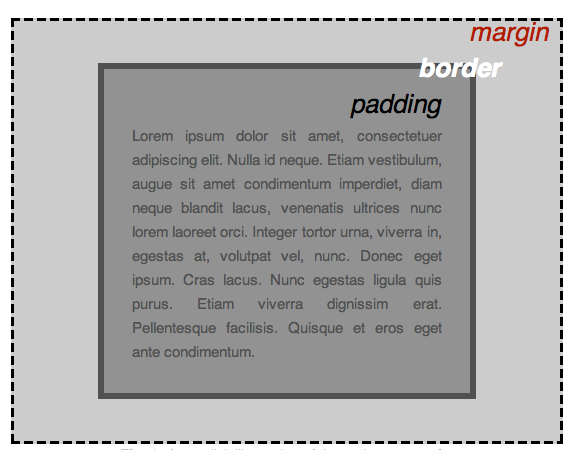
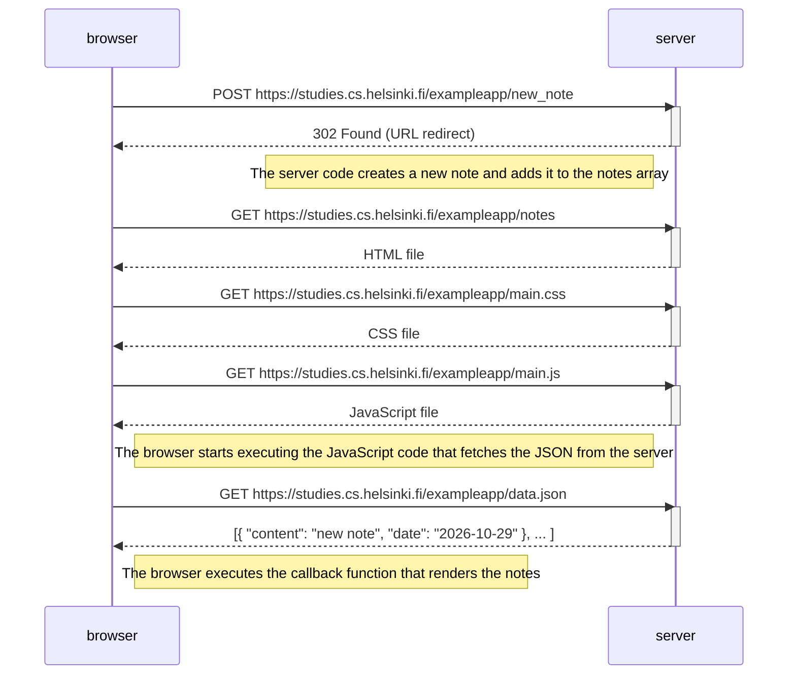

# Part 0 - Fundamentals of Web apps
## 0.1 HTML
- HTML  = **H**yper**T**ext **M**arkup **L**anguage
- Consists of a series of elements used to wrap text content to define its structure and make it behave in a certain way.
    - Aside from structure, HTMl can be used to create links, embed media, create data tables, etc.
- example:
```html
<!doctype html>
<html lang="en-US">
  <head>
    <meta charset="utf-8" />
    <meta name="viewport" content="width=device-width" />
    <title>My test page</title>
  </head>
  <body>
    
  </body>
</html>
```
- HTML structure:
    - `<!doctype html>` is a required preamble for HTML files
        - the doctype was meant to link to a set of rules that the HTML page had to follow, but nowadays they don't do much.
    - `<html></html>` wraps the content of the entire page. Also known as the **root element**
    - `<head></head>` contains everything that isn't content to show to the page's viewers directly. It can contain keywords for search engines, a page description, CSS, etc.
    - `<meta charset="utf-8">` sets the character set for the document. In this case it is set to UTF-8, which contains most characters from the majority of written languages. Setting this can help avoid problems later on.
    - `<meta name="viewport" content="width=device-width">` ensures the page renders to the width of the browser's viewport, which is helpful to prevent mobile devices from first rendering a page and then shrinking it down.
   - `<title></title>` sets the title of the page which also appears in the browser tab.
   - `<body></body>` contains **all** the content that is to be shown to users when they visit the page.
- The `` element can be used to embed images.
    - The `src` attribute defines the source path to the image file.
    - The `alt` attribute contains descriptive text for users who can't see the image (such as the visually impaired or in case the image fails to display).
- Some elements (such as ``) don't contain a closing tag and are called **empty** or void elements.
    - They can optionally be written with a **trailing slash** (e.g. ``), but this is optional.
- Heading elements (`<h1>`-`<h6>`) can be used to specify headings and subheadings.
- Comments are enclosed by `<!--` and `-->`. These are ignored by the browser and are only visible in the code.
- `<p>` elements contain paragraphs of text.
- `<ul>` is used for lists where the the order doesn't matter.
- `<ol>` is used for ordered lists.
- Each item inside a list is put into a `<li>` element.
- `<a>` (short for anchor) elements are used to add links to the enclosed text.
    - the `href` (**h**pertext **ref**erence) attribute is used to specify the link address.

## 0.2 CSS
- CSS = **C**ascading **S**tyle **S**heets
- CSS is used to style HTML elements by selecting them and setting values for their style properties.
- CSS **selectors** can be the name of an HTML element, which will select all of the elements with that name in the associated HTML.
- CSS has many functions such as specifiying background images, gradients, controlling typography and scrolling behaviour, to adding animations and building web page layouts.
- Example:
```css
p {
  color: red;
}
```
- CSS structure:
    - lines inside the curly braces (`{ }`) are called **declarations**.
    - in the example above the **property** `color` is set to the **property value** of `red`.
    - the whole structure is called a **ruleset** (or just rule).
    - lines within a ruleset are seperated with semicolons.
    - multiple selectors can be used in one rule, seperated by commas.

- A CSS file can be linked to a HTML file by using the `<link>` element in the header.
```html
<link href="styles/style.css" rel="stylesheet" />
```
- If you want to use fonts not generally included with devices, you need to include them with the website files or reference them from a third party font service.
```html
<link rel="preconnect" href="https://fonts.googleapis.com" />
<link rel="preconnect" href="https://fonts.gstatic.com" crossorigin />
<link
  href="https://fonts.googleapis.com/css2?family=Roboto:ital,wght@0,100..900;1,100..900&display=swap"
  rel="stylesheet" />
```

```css
font-family: "Roboto", sans-serif;
```

- HTML elements on a page can be thought of as boxes that sit on top of or alongside other boxes. This is referred to as the **box model**.
    - `padding` is the pace around the content
    - `border` is a solid line around the padding
    - `margin` is the space outside the border



- CSS property values taht can set multiple properties at once are called **shorthand properties**.
    - An example for this is using `padding: 0 20px 20px 20px` rather than
```css
padding-top: 0;
padding-right: 20px;
padding-bottom: 20px;
padding-left: 20px;
```

- To center an element horizontally we can set `margin` to `0 auto`.
    - The first value affects the elements top and bottom side and the second value affects it's left and right side.
        - This behaviour can also be applied to `padding`.
    - `auto` is a special value that divides available space evenly between the sides.
- `<body>` is a **block** element by default. There are also **inline** elements such as ``.
    - inline elements don't accept margin values, so to center an inline element, it must first be given block-level behaviour by setting `display: block;`.

## 0.3 HTML forms
- Forms can be used to enter and send data to a web server or on the client-side to immediately update the interface.
- A web form is made up of one or more **form controls** (or **widgets**).
    - Controls can be: single- or multiline text fields, dropdown boxes, buttons, checkboxes or radio buttons.
    - Most are created using the `<input>` element.
- Form controls can be used to enforce specific formats or values (**form validation**).
- The bigger your form, the more you risk frustrating users. **Keep it simple.*
- Example code:
```html
<form action="/my-handling-form-page" method="post">…</form>
```
- The `action` attribute defines the URL the form is sent to when submitted.
- The `method` attribute defines the HTTP method to send the data with.
- Further example code:
```html
<form action="/my-handling-form-page" method="post">
  <p>
    <label for="name">Name:</label>
    <input type="text" id="name" name="user_name" />
  </p>
  <p>
    <label for="mail">Email:</label>
    <input type="email" id="mail" name="user_email" />
  </p>
  <p>
    <label for="msg">Message:</label>
    <textarea id="msg" name="user_message"></textarea>
  </p>
</form>
```
- The `type` attribute defines how the input element appears and behaves.
- The `<button>` element is used to submit data or interact with the form. The value of its `type` attribute determines what the button does.
    - `type="submit"` send the form's data to the web page defined by the `action` attribute on the `<form>` element
    - `type="reset"` resets all of the form widgets to their default value.
        - This is considered bad practice in UX
    - `type="button"` does nothing on its own, but is meant to be used in conjunction with JavaScript.
- Each form control can have a `name` attribute which allows the server to handle each piece of data by name.
- A script at the URL specified in the `action` attribute receives the form data as a list of key/value pairs.

## 0.4 New note diagram


